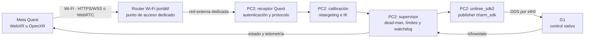
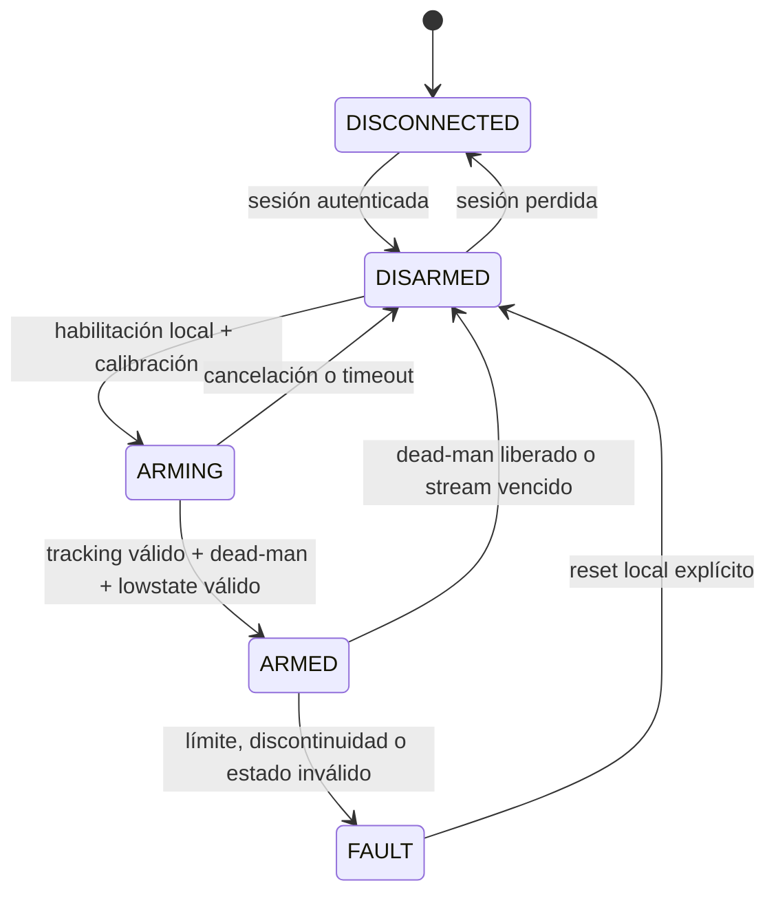

# Arquitectura canónica Quest → G1

## Decisión

**Estado:** aceptada y obligatoria para las siguientes fases del proyecto.

La arquitectura del sistema será siempre:

```text
Meta Quest → router Wi-Fi portátil → PC2 → unitree_sdk2/CycloneDDS → G1
```

No habrá una computadora externa en el camino de control. El gateway, el
retargeting, la máquina de estados de seguridad y la única publicación DDS
hacia el robot se ejecutarán en PC2.

La aplicación de Quest podrá comenzar como WebXR y evolucionar a OpenXR nativo
sin cambiar esta arquitectura.

## Topología



El router es solamente infraestructura de red. No calcula poses, no ejecuta
el SDK y no decide si el robot puede moverse.

## Fronteras de red

PC2 tendrá dos lados lógicos separados:

1. **Red interna del G1**
   - Interfaz de referencia: `eth0`.
   - Subred actual: `192.168.123.0/24`.
   - PC1 observado: `192.168.123.161`.
   - PC2 observado: `192.168.123.164`.
   - Solo aquí se inicializan CycloneDDS y `unitree_sdk2`.

2. **Red Quest**
   - Router Wi-Fi portátil dedicado.
   - Quest se conecta al SSID del proyecto.
   - PC2 se conecta al lado LAN del router mediante una segunda interfaz,
     preferentemente Ethernet/USB-Ethernet para que el salto PC2 ↔ router sea
     cableado.
   - Subred propuesta: `10.42.0.0/24`; la dirección final se fijará cuando se
     elija y pruebe el router.

No se creará un bridge de capa 2 entre ambas redes, no se reenviará multicast
DDS al Wi-Fi y el Quest no tendrá acceso directo a PC1 ni a los topics del G1.
El gateway de aplicación es la única frontera entre las dos redes.

## Responsabilidades

### Meta Quest

- Captura pose y validez de tracking del visor y los dos controladores.
- Captura botones, gatillos, sticks y el dead-man switch.
- Envía secuencia, timestamp monotónico, heartbeat y datos de entrada.
- Muestra `DISCONNECTED`, `DISARMED`, `ARMING`, `ARMED` o `FAULT`
  recibidos desde PC2.
- Nunca calcula ni envía torque, `kp`, `kd` o mensajes DDS.

### Router Wi-Fi portátil

- Proporciona una LAN cerrada entre Quest y PC2.
- No necesita Internet para operar.
- No participa en el control ni en las decisiones de seguridad.
- Debe configurarse con SSID y credenciales exclusivos para el proyecto.

### PC2

- Sirve o recibe la sesión de Quest.
- Autentica una sola sesión de control activa.
- Descarta paquetes duplicados, fuera de orden o vencidos.
- Convierte coordenadas Quest al marco del torso del G1.
- Ejecuta calibración, filtrado, retargeting e IK.
- Verifica límites articulares, velocidad, aceleración y continuidad.
- Mantiene el watchdog y la máquina de estados de seguridad.
- Lee `rt/lowstate` y es el único componente que puede publicar
  `rt/arm_sdk`.
- Devuelve al Quest estado, tracking, latencia, fallos y telemetría resumida.

## Flujo de datos

El Quest envía **intención cartesiana**, no comandos de motor. Cada muestra
deberá contener como mínimo:

- versión de protocolo e identificador de sesión;
- número de secuencia;
- timestamp monotónico del Quest;
- pose del visor, controlador izquierdo y controlador derecho;
- validez de posición y orientación de cada dispositivo;
- botones, gatillos, sticks y dead-man;
- heartbeat.

PC2 estimará la relación entre los relojes mediante intercambio de mensajes;
no comparará directamente timestamps monotónicos de dispositivos distintos.
Para el lazo vivo se conservará solamente la muestra válida más reciente: un
paquete retrasado nunca debe provocar la reproducción de una trayectoria vieja.

La primera implementación WebXR utilizará HTTPS y WSS en la LAN. El protocolo
de aplicación será independiente del transporte para permitir WebRTC
DataChannel u OpenXR nativo más adelante sin modificar el gateway de seguridad
ni la interfaz DDS.

## Autoridad y estados de seguridad

PC2 es siempre la autoridad final. El estado inicial y el estado después de
cualquier reconexión es `DISARMED`.



Condiciones mínimas para permanecer en `ARMED`:

- sesión autenticada y única;
- `rt/lowstate` reciente y válido;
- tracking requerido válido;
- dead-man mantenido continuamente;
- muestra Quest dentro del TTL;
- objetivos dentro de límites y sin discontinuidades;
- supervisor y publisher funcionando a la frecuencia esperada.

Ante pérdida del Quest o del router, PC2 deja de aceptar objetivos
inmediatamente y ejecuta una salida controlada de `rt/arm_sdk`. Los tiempos de
hold, rampa y watchdog se determinarán con pruebas progresivas y con el robot
soportado; no dependerán del timeout de TCP ni del navegador.

## Alcance de movimiento

- Primer alcance: dos brazos de 7 DOF.
- Las manos simples son pasivas y no reciben comandos.
- Cintura y piernas permanecen bajo control nativo del G1.
- No se habilitará locomoción desde Quest en estas fases.
- La primera publicación real se probará con el G1 soportado, espacio libre,
  límites conservadores y parada local disponible.

## Elementos fuera de arquitectura

Quedan fuera del diseño de ejecución:

- Mac, PC de escritorio o laptop como gateway intermedio;
- Raspberry Pi u otra computadora auxiliar;
- LTE, 5G, Internet, VPN o servidores externos;
- LoRa o enlaces de telemetría de largo alcance;
- DDS directo desde Quest;
- conexión del Quest a la red interna `192.168.123.0/24`.

Una estación de desarrollo puede editar, compilar, copiar archivos o analizar
logs, pero no forma parte del camino operativo y puede apagarse después del
despliegue.

## Criterios de aceptación de la red

Antes de permitir cualquier movimiento se validará en modo de solo registro:

- conexión y reconexión de Quest sin intervención en DDS;
- tasa recibida, RTT, jitter, pérdida y paquetes fuera de orden;
- pérdida de Wi-Fi, cierre del navegador y suspensión del visor;
- tracking perdido por cada controlador;
- dead-man liberado;
- reinicio del router y del servicio de PC2;
- confirmación de que todos los casos terminan en `DISARMED`;
- confirmación de que DDS permanece ligado únicamente a la interfaz interna.

## Referencias técnicas

- [Unitree XR Teleoperate](https://github.com/unitreerobotics/xr_teleoperate)
- [Ejemplo oficial G1 `rt/arm_sdk`](https://github.com/unitreerobotics/unitree_sdk2/blob/main/example/g1/high_level/g1_arm7_sdk_dds_example.cpp)
- [WebXR Device API](https://www.w3.org/TR/webxr/)
- [WebRTC](https://www.w3.org/TR/webrtc/)
